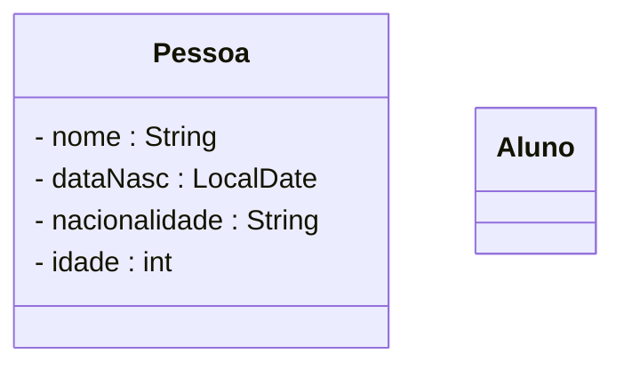
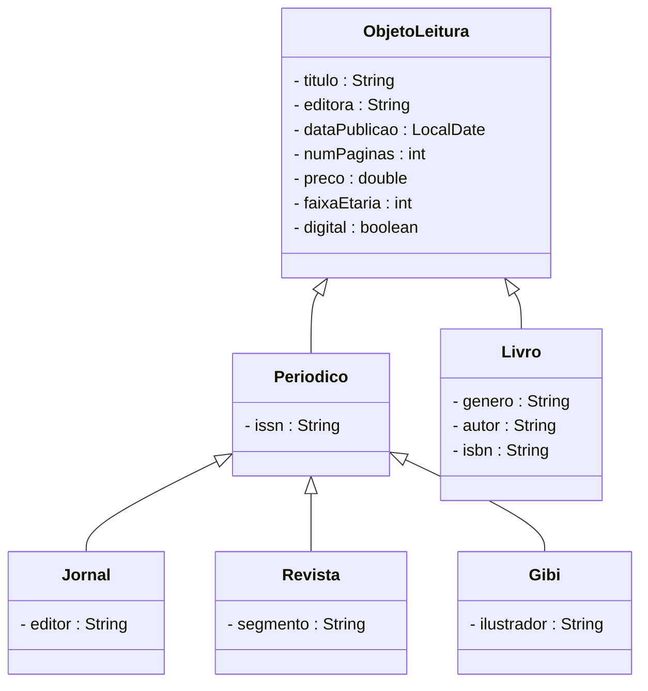

# 1


# 2


# 3 
````mermaid
classDiagram
    class Veiculo{
        - nome : String
        - marca : String
        - anoFabricacao: LocalDate
        - velocidadeMaxima : double
        - motor : Motor
    }
    class Carro{
        - 
    }
    class Caminhao{
        
    }
    class Barco{
        
    }
    class Aviao{
        
    }
    class Motor{
        
    }
    
````